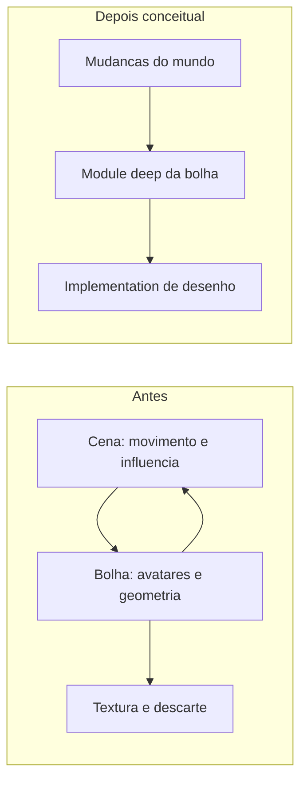
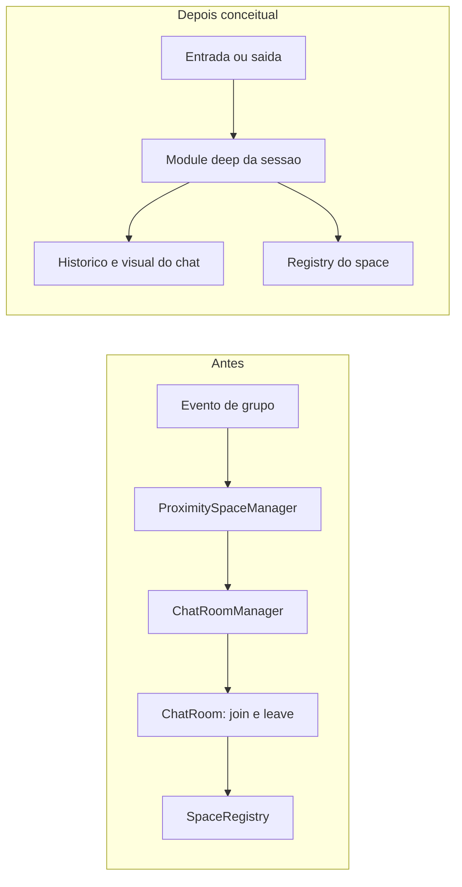
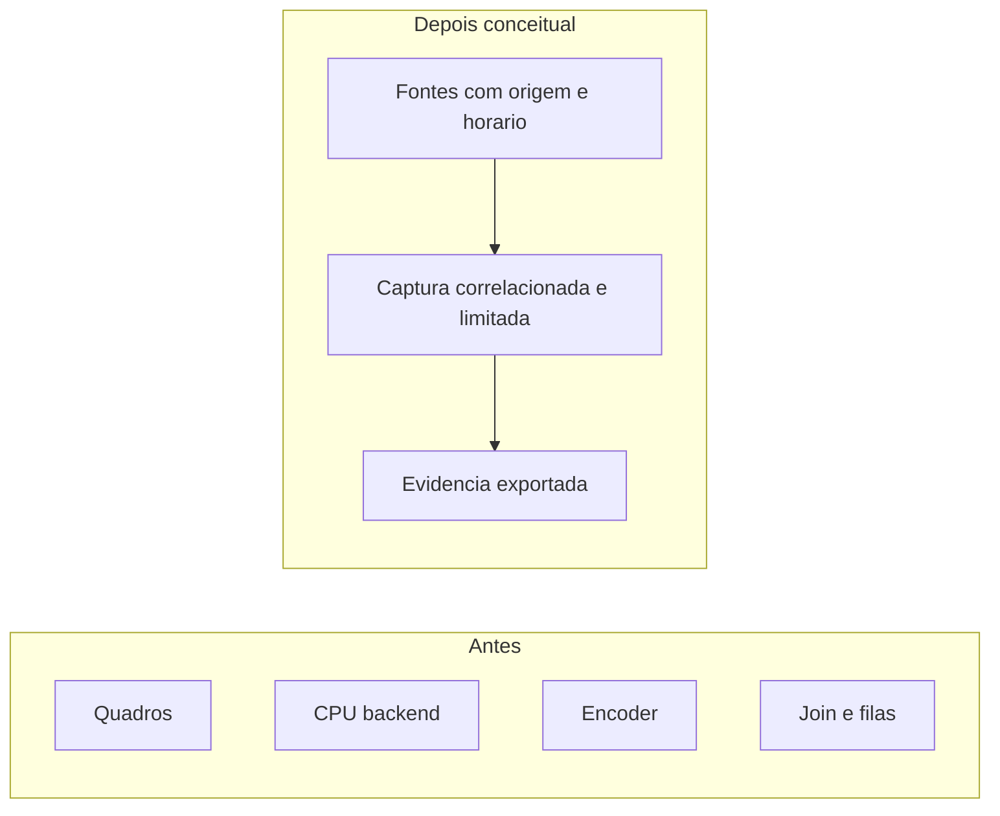
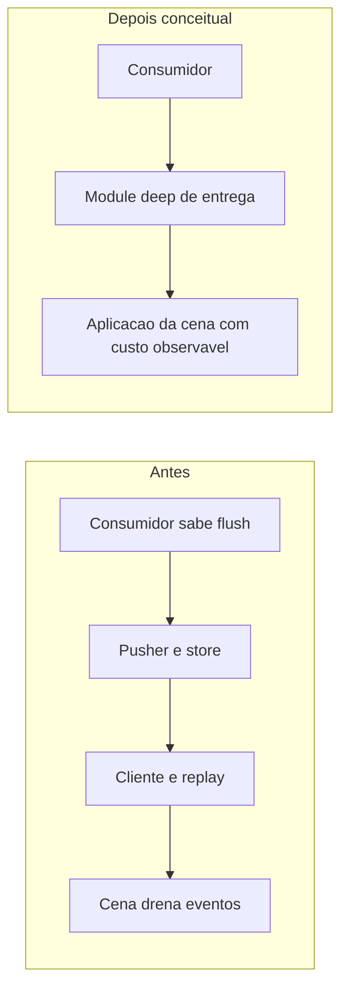
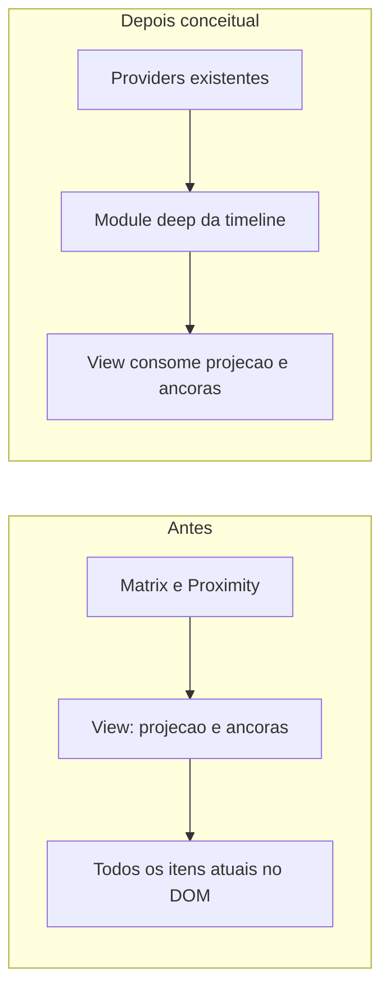

# Oportunidades de aprofundamento dos modules

**Primeira investigação arquitetural recomendada: A02, ciclo de vida da sessão de proximidade. Primeiro experimento de desempenho: P0, seguido de H01/H02/H11.** São decisões diferentes: fricção estrutural não determina o maior consumidor de CPU.

Este documento acompanha o [registro H01–H22](README.md) e o [protocolo](investigation-plan.md). A avaliação é estática, sobre o checkout local descrito no README, com o HEAD registrado e alterações locais anteriores. Não houve refatoração, execução dos testes citados ou benchmark com oito participantes. O [relatório HTML](architecture-review.html) apresenta os mesmos cinco candidatos visualmente.

## Vocabulário e limites

| Termo               | Uso neste documento                                                                                                                |
| ------------------- | ---------------------------------------------------------------------------------------------------------------------------------- |
| module              | Código com interface e implementation, independentemente de tamanho ou arquivo                                                     |
| interface           | Tudo que quem chama precisa saber, incluindo ordem, falhas, configuração e custo                                                   |
| depth               | Quanto comportamento fica concentrado atrás de uma interface pequena; deep concentra, shallow repassa complexidade                 |
| seam e adapter      | Ponto de variação e implementação concreta que o satisfaz; um adapter torna a seam hipotética, dois podem demonstrar variação real |
| locality e leverage | Conhecimento e correção concentrados; uma implementação útil a vários consumidores e testes                                        |

O deletion test pergunta para onde vai a complexidade quando um module desaparece. Se desaparece junto, ele pode ser um repasse dispensável. Se reaparece nos consumidores, sua responsabilidade precisa continuar concentrada em algum lugar. A interface é a superfície de teste; extrair funções apenas para facilitar mocks pode reduzir locality.

Não foram encontrados `GLOSSARY.md` nem arquivos em `docs/adr/` na descoberta delimitada. Usamos os conceitos já presentes no código: sala, jogador, movimento, bolha de conversa, sessão de proximidade, space, timeline e reconexão. Sala do mapa, grupo por proximidade e space de comunicação não são sinônimos. A ausência de ADRs encontrados não demonstra ausência de decisões históricas.

Os diagramas mostram ownership conceitual proposto, não interfaces TypeScript, novos contratos ou uma autorização para executar todas as mudanças. Os selos significam força da recomendação de explorar, não probabilidade de causar o incidente.

## A01. Concentrar atualização e desenho da bolha de conversa

**Worth exploring · in-process · H01/H02/H03 · D02**

**Files:** [GameScene.ts](../../../play/src/front/Phaser/Game/GameScene.ts#L1498), [ConversationBubble.ts](../../../play/src/front/Phaser/Entity/ConversationBubble.ts#L78), [Game.ts](../../../play/src/front/Phaser/Game/Game.ts#L52).

**Problema.** A interface entre os modules da cena e da bolha exige conhecer pertencimento, raio de influência, invalidação por movimento, conversão de avatares e animação; a implementation da bolha também conhece identidade da conexão, cena, geometria e vida da textura. A fricção está no conhecimento cruzado, não no número de arquivos.

**Evidência.** A cena seleciona bolhas afetadas e prepara avatares. A bolha calcula amostras do contorno e substitui a textura. Já há índice espacial, seleção de bolhas que precisam avançar e limpeza. Não há demonstração de redesenho incondicional.

| Antes                                                          | Depois conceitual                                                                    |
| -------------------------------------------------------------- | ------------------------------------------------------------------------------------ |
| Cena conhece regras da bolha; bolha conhece detalhes da cena   | Module da bolha concentra pertencimento, influência, avanço e necessidade de desenho |
| Geometria, identidade e textura se misturam na mesma interação | Cena fornece mudanças do mundo; desenho permanece implementation interna             |

**Solução.** Aprofundar o module existente para absorver as regras hoje exigidas dos consumidores; medir separadamente se reutilizar desenho reduz custo. Não criar um module intermediário que apenas encaminha chamadas.

**Depth, locality e leverage.** Verificar comportamento da bolha sem iniciar toda a cena; concentrar regras que atendem movimento local e remoto. A interface futura ainda precisa de exploração, não é definida aqui.

**Seam e adapter.** O cálculo é in-process. Phaser é o único adapter de desenho observado; uma seam universal de renderização seria hipotética. Preferir uma separação interna suficiente ao caso real.

**Deletion test.** Remover um repasse não acrescenta comportamento. Remover o module deep proposto espalharia geometria, invalidação e descarte de volta pela cena, justificando concentrar essa responsabilidade.

**Superfície de teste.** Bolha estável deixa de gerar trabalho visual; movimento dentro/fora da influência atualiza o contorno; retirada de membro e destruição liberam recursos; comportamento fora da tela permanece correto. A busca delimitada não encontrou arquivo dedicado de teste de `ConversationBubble`/`GameScene`. Isso não prova ausência de cobertura indireta. `say_bubbles.spec.ts` cobre balões de fala e não deve ser apresentado como cobertura do contorno de conversa.

**Gate.** H01/H02 precisam demonstrar custo ou um defeito de comportamento/testabilidade concreto. Ganho de depth e ganho de FPS são verificações separadas. Reversão restrita à cena/bolha, preservando aparência e recursos.

## A02. Concentrar o ciclo de vida da sessão de proximidade

**Strong · mock no transporte remoto · H10/H11/H13 · D03/D07**

**Files:** [ProximitySpaceManager.ts](../../../play/src/front/WebRtc/ProximitySpaceManager.ts#L14), [ProximityChatRoomManager.ts](../../../play/src/front/Chat/Connection/Proximity/ProximityChatRoomManager.ts#L89), [ProximityChatRoom.ts](../../../play/src/front/Chat/Connection/Proximity/ProximityChatRoom.ts#L1359), [SpaceRegistry.ts](../../../play/src/front/Space/SpaceRegistry/SpaceRegistry.ts#L337).

**Problema.** Quem coordena entrada e saída precisa conhecer cancelamento, serialização, reuso da sala, registro do space, espera de participantes, estado visual e descarte. Essa interface efetiva está distribuída entre modules.

**Evidência.** `ProximitySpaceManager` documenta que uma operação sem abort pode segurar entradas seguintes durante a espera de participante de nove segundos. `ProximityChatRoomManager` protege outra corrida de entrada/saída e serializa bolhas padrão por uma chave de sala visual. `SpaceRegistry` já reúne joins concorrentes e espera joins pendentes durante destruição. As proteções existentes são parte da solução atual, não código a remover automaticamente.

| Antes                                                                                           | Depois conceitual                                                                                |
| ----------------------------------------------------------------------------------------------- | ------------------------------------------------------------------------------------------------ |
| Tradução de evento, abort, ordenação, espera e descarte exigem coordenação entre quatro modules | Module da sessão de proximidade possui a identidade da operação e seu cancelamento até o término |
| Chat e transporte participam de decisões de duração da operação                                 | Chat conserva histórico/interface visual; registry conserva ownership do transporte do space     |

**Solução.** Concentrar ownership da operação, cancelamento e ordenação em um module de sessão, mantendo as responsabilidades de histórico e transporte onde já pertencem. A exploração deve decidir se isso cabe em um module existente antes de criar outro.

**Depth, locality e leverage.** A interface de entrada/saída deixa de exigir conhecimento de timeout e chave de serialização. Uma correção de operação obsoleta atende os diferentes pontos de entrada, com verificação no mesmo lugar.

**Seam e adapter.** `RoomConnectionForSpacesInterface` já tem transporte real e `MockRoomConnectionForSpaces`. Essa seam é concreta. Não adicionar outra interface genérica de ciclo de vida só para renomear os modules.

**Deletion test.** O encaminhamento simples pode desaparecer; cancelamento e ordenação não desaparecem, pois reapareceriam nos consumidores de bolhas e zonas. Aprofundar concentra essa complexidade.

**Superfície de teste.** Entrar/sair/reentrar rapidamente, interromper join antes do primeiro peer, leave obsoleto, destruir durante join e preservar histórico. Pontos existentes: [ProximitySpaceManager.test.ts](../../../play/tests/front/WebRtc/ProximitySpaceManager.test.ts), [ProximityChatRoomManager.test.ts](../../../play/tests/front/Chat/Connection/ProximityChatRoomManager.test.ts), [SpaceRegistry.test.ts](../../../play/src/front/Space/tests/SpaceRegistry.test.ts), [SpaceIntegration.test.ts](../../../play/src/front/Space/tests/SpaceIntegration.test.ts).

**Gate.** Mostrar onde uma regra precisa ser conhecida por mais de um consumidor ou reproduzir falha de ordenação/cancelamento. O `destroy` externo que só remove subscription é sinal para revisar ownership, não prova de vazamento: considerar a limpeza encadeada. Reversão deve preservar as proteções atuais.

## A03. Correlacionar evidências de uma sessão de diagnóstico

**Strong para investigar · Speculative para criar module · in-process · H01–H22 · D01/D04**

**Files:** [CpuTracker.ts](../../../back/src/Services/CpuTracker.ts#L14), [CpuLimitationDetector.ts](../../../play/src/front/WebRtc/CpuLimitationDetector.ts#L15), [Game.ts](../../../play/src/front/Phaser/Game/Game.ts#L52), [EnvironmentVariableValidator.ts](../../../back/src/Enum/EnvironmentVariableValidator.ts), [Helm values](../../../contrib/helm/values.yaml#L57).

**Problema.** As interfaces atuais observadas respondem a perguntas distintas: CPU do processo, limitação do encoder, estado de conexão e elegibilidade de desenho. Reconstruir o incidente exige correlacionar sinais e configuração efetiva externamente.

**Evidência.** O detector de mídia usa o diagnóstico do encoder libwebrtc, que não representa toda a CPU do navegador. O tracker do backend é relativo ao processo; o update da cena pode ocorrer sem desenho. A busca delimitada por `PerformanceObserver`, `longtask`, `performance.mark` e `monitorEventLoopDelay` não encontrou esses padrões nas fontes TypeScript examinadas. Isso não audita toda a observabilidade externa.

| Antes                                                                           | Depois conceitual                                                             |
| ------------------------------------------------------------------------------- | ----------------------------------------------------------------------------- |
| Perfis, configuração, CPU, joins e conexão precisam ser conciliados manualmente | Captura delimitada possui relógio/correlação e exporta evidência com contexto |
| Sinal de encoder pode ser confundido com CPU geral                              | Cada sinal conserva origem, unidade, escopo e semântica                       |

**Solução.** Primeiro executar captura com ferramentas existentes e registrar configuração não sensível. Somente se a repetição revelar duplicação real, explorar um module que concentre correlação e limites de captura. Políticas de recuperação permanecem nos seus donos.

**Depth, locality e leverage.** Uma evidência legível distingue travamento de quadro, limitação de encoder e espera de join. Evita que cada reprodução invente outra interpretação dos mesmos sinais.

**Seam e adapter.** Nenhuma seam comum de diagnóstico foi estabelecida. Não criar adapter abstrato de analytics por antecipação. `CpuLimitationDetector.sample` já separa decisão de efeitos e possui testes; preservar sua depth.

**Deletion test.** Um module só se justifica se sua remoção duplicar correlação, limites e exportação entre produtores reais. Um repasse para telemetria falha nesse teste.

**Superfície de teste.** Captura limitada em duração/tamanho, ordenação determinística, descarte, mídia desativada e atribuição de espera. [CpuLimitationDetector.test.ts](../../../play/src/front/WebRtc/CpuLimitationDetector.test.ts), [LocalEncoderStats.test.ts](../../../play/tests/front/WebRtc/LocalEncoderStats.test.ts) e [WebRtcStatsFactory.test.ts](../../../play/tests/front/WebRtc/WebRtcStatsFactory.test.ts) são evidências de testes existentes, não de diagnóstico ponta a ponta.

**Gate.** P0 independe de uma nova interface. Não coletar áudio, mensagens, tokens ou conteúdo pessoal para medir duração. Limitar custo da instrumentação e removê-la quando temporária. Reversão não altera lógica do produto.

## A04. Aprofundar garantias de entrega, retenção e recuperação

**Worth exploring · in-process na retenção; mock no transporte remoto · H15/H18/H19 · D05**

**Files:** [PusherWebSocket.ts](../../../play/src/pusher/services/PusherWebSocket.ts#L49), [NoncedMessageStore.ts](../../../play/src/common/NoncedMessageStore.ts#L18), [WorkAdventureWebSocket.ts](../../../play/src/front/Connection/WorkAdventureWebSocket.ts#L63), [SocketManager.ts](../../../back/src/Services/SocketManager.ts#L257), [GameScene.ts](../../../play/src/front/Phaser/Game/GameScene.ts#L1454).

**Problema.** A interface efetiva exige conhecimento de flush, replay, nonces, drenagem e consumo. Sobrecarga no backend e aplicação de eventos no navegador possuem políticas distintas, cuja interação precisa ficar observável.

**Evidência.** O pusher documenta ordenação que exige flush; `NoncedMessageStore` retém por tempo, cria snapshots para replay e não possui limite de bytes/contagem nessa implementation. O cliente reproduz mensagens retidas; a cena drena sua fila de eventos. Isso não comprova filas excessivas com oito pessoas.

| Antes                                                                         | Depois conceitual                                                                       |
| ----------------------------------------------------------------------------- | --------------------------------------------------------------------------------------- |
| Consumidores precisam conhecer flush/replay/drain; exaustão pouco concentrada | Modules de entrega existentes possuem garantias e resultados de exaustão explícitos     |
| Transporte e execução de eventos podem ser tratados como um único custo       | Entrega ordenada e orçamento de aplicação da cena continuam responsabilidades distintas |

**Solução.** Aprofundar os modules existentes com garantias de retenção/recuperação e resultado de exaustão verificáveis, após definir classes de mensagens. Não criar um controlador universal de CPU, rede e frames.

**Depth, locality e leverage.** Slow consumer e replay tornam-se comportamento verificável através da interface do dono; consumidores não reproduzem regras de flush. A definição concreta dessa interface fica para a exploração escolhida.

**Seam e adapter.** O cliente já usa factory e `FakeWebSocket`. Cliente e pusher possuem contratos diferentes e não são adapters intercambiáveis apenas por usar WebSocket. O store compartilhado é in-process.

**Deletion test.** Remover retenção elimina semântica de reconexão ou a espalha pelos consumidores. Adicionar uma fachada que só encaminha fila acrescentaria indirection sem depth.

**Superfície de teste.** Ordem entre patches e respostas, drenagem, exaustão limitada, replay sem duplicação e posição final sob sobrecarga. Reusar [WorkAdventureWebSocket.test.ts](../../../play/tests/front/Connection/WorkAdventureWebSocket.test.ts) e [SocketManagerSpaceStateQuery.test.ts](../../../play/tests/pusher/SocketManagerSpaceStateQuery.test.ts). Seus nomes e casos existentes não provam comportamento de carga.

**Gate.** Medir filas e conferir trabalho upstream citado na auditoria anterior. Limites novos não podem descartar estado durável silenciosamente. Reversão deve considerar clientes conectados, nonces e compatibilidade de replay.

## A05. Concentrar projeção e navegação da timeline

**Worth exploring · in-process na projeção; DOM verificado no navegador · H05/H10 · D06**

**Files:** [ChatConnection.ts](../../../play/src/front/Chat/Connection/ChatConnection.ts#L157), [ProximityTimelineItemsStore.ts](../../../play/src/front/Chat/Connection/Proximity/ProximityTimelineItemsStore.ts#L9), [RoomTimeline.svelte](../../../play/src/front/Chat/Components/Room/RoomTimeline.svelte#L281).

**Problema.** A interface fornece coleções de timeline, enquanto a view precisa conhecer agrupamento, datas, posição de não lidas, âncoras de paginação e geometria DOM. O custo varia com histórico e detalhes de navegação.

**Evidência.** O store de proximidade reconstrói e ordena itens. A view deriva linhas, percorre elementos e monta a coleção atual. Paginação e limites de recuperação de read marker já existem; não se demonstrou carregamento ilimitado de todo o histórico remoto.

| Antes                                                  | Depois conceitual                                                            |
| ------------------------------------------------------ | ---------------------------------------------------------------------------- |
| View coordena projeção, âncora, paginação e geometria  | Module da timeline concentra projeção estável e semântica de viewport/âncora |
| Cada consumidor precisa conhecer a ordem dessas regras | Providers conservam busca e significado das mensagens                        |

**Solução.** Aprofundar o ownership da projeção e das âncoras, preservando significado e busca nos providers. Janela de renderização é uma otimização condicional ao perfil, não uma consequência obrigatória da extração.

**Depth, locality e leverage.** Uma interface comportamental concentra correções de posição e leitura para Matrix, proximidade e threads, sem cada view reaprender as mesmas regras.

**Seam e adapter.** `ChatRoom` já tem implementations Matrix e Proximity, uma seam com variação real de adapter. Não adicionar outro module genérico de provider. Cálculo de projeção pode continuar interno.

**Deletion test.** Tirar a responsabilidade de âncora/projeção espalha conhecimento pelas views. Extrair somente funções `.map`/`.sort` não melhora depth por si só.

**Superfície de teste.** Append enquanto usuário lê acima, prepend sem salto, não lidas, redaction, perguntas/polls e limpeza ao trocar sala. Reusar [RoomTimelineNewMessages.test.ts](../../../play/src/front/Chat/Components/Room/RoomTimelineNewMessages.test.ts), [RoomTimelineHeaderLayout.test.ts](../../../play/src/front/Chat/Components/Room/RoomTimelineHeaderLayout.test.ts) e [ProximityTimelineItemsStore.test.ts](../../../play/tests/front/Chat/Connection/ProximityTimelineItemsStore.test.ts). Validar também interação real e acessibilidade.

**Gate.** Medir visibilidade e tamanho do histórico no caso problemático. Oito pessoas não implicam timeline grande. Decidir busca, seleção, foco e recibos antes de janela de renderização; reverter view e projeção juntas.

## Recomendação

Explorar **A02** primeiro para esclarecer ownership de operações concorrentes: há regras de cancelamento e ordenação documentadas em vários modules e testes existentes que permitem preservar comportamento. Isso é uma recomendação arquitetural, não uma afirmação de causa do congelamento.

Executar **P0** antes de escolher uma otimização de desempenho. Se H01 dominar o perfil, A01 passa à frente na implementação. Se o problema for cota de CPU, corrigi-la pode resolver o incidente sem refatoração. A03 começa com ferramentas existentes, sem projetar uma interface nova.

Nenhum candidato foi confrontado com um ADR encontrado, porque nenhum ADR foi localizado no escopo da descoberta. Não criar glossário ou decisão definitiva enquanto nomes e ownership ainda forem propostas. A próxima discussão escolhe um candidato e explicita restrições, invariantes e comportamento que os testes precisam preservar.
