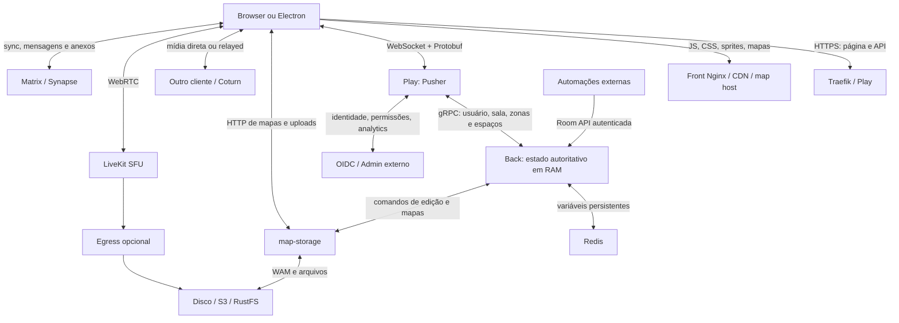

# WorkAdventure: stack, arquitetura, dados e oportunidades de performance

Análise concluída sobre o commit **ddbe245a84c78c947dd9ae5310da1fc53cd3d278**, em 11/11/2026. O foco é o código aberto deste checkout. O painel comercial, os serviços externos e as imagens de terceiros são fronteiras separadas.

A conclusão principal é que a performance precisa ser tratada em quatro caminhos independentes: renderização e trabalho do navegador; distribuição do estado do mundo; mídia WebRTC/LiveKit/TURN; persistência e assets. Aumentar a máquina do backend de posições não resolve automaticamente um encoder de vídeo saturado no notebook, uma textura muito grande ou excesso de saída do SFU.

Este é um diagnóstico estático com inventário quantitativo de arquivos e dependências, não um benchmark. As oportunidades são hipóteses fundamentadas em caminhos concretos do código. Não há ganho percentual medido, especificação universal de hardware mínimo ou número de usuários garantido. Veja [escopo e método](SCOPE.md).

## 1. Stack completa e linguagens

O monorepo usa npm workspaces: **16 workspaces na raiz**, **21 package.json** ao incluir instalações independentes. Foram encontrados **419 registros de dependências diretas**, correspondentes a **217 nomes distintos**, incluindo bibliotecas internas e ferramentas. O lockfile raiz tem **1.428 posições de instalação**. Os cinco lockfiles npm somam **2.901 posições**, **1.919 pares nome/versão** e **1.467 nomes distintos**; os dois Yarn locks têm mais **97 grupos de seletores**, com sobreposição. Esses números não representam tudo que vai para o navegador.

O [inventário completo](DEPENDENCIES.md) lista cada declaração, versão e arquivo de origem. Os CSV ao lado incluem todas as entradas transitivas dos lockfiles. Os componentes abaixo são o mapa funcional dessa lista.

| Área | Tecnologias e versões encontradas | Responsabilidade |
|---|---|---|
| Aplicação web | TypeScript 5.9.3, Svelte 5.55.9, Tailwind 4.3.0, Vite 8.1.4 | UI, menus, chat, controles, compilação e entrega de módulos |
| Mundo 2D | Phaser 4.2.0, phaser4-rex-plugins 4.0.7, Arcade Physics, EasyStar.js | Canvas/WebGL, sprites, tilemaps, câmera, colisões e pathfinding |
| Estado reativo | Svelte stores e RxJS 7.8.2 | Atualizações de UI, eventos de rede, mídia e lifecycle |
| Gateway do jogo | Node.js 24, Express 5.2.1, HyperExpress 6.17.3, uWebSockets.js 20.67.0 | HTTP, autenticação, WebSocket, encaminhamento e replay |
| Backend do mundo | Node.js 24/TypeScript, gRPC JS 1.14.4, Protobuf, ts-proto | Estado autoritativo em memória, salas, presença, grupos e comunicação |
| Persistência de variáveis | Redis servidor 6 nos exemplos; cliente npm 5.12.1 | Hashes de variáveis persistentes por sala e usuário |
| Mapas e edição | Tiled JSON/TMJ, WAM, Zod, fast-json-patch, Express, disco/S3 | Arquivos, entidades, áreas, comandos de edição e autosave |
| Mídia | WebRTC, fork @workadventure/simple-peer, LiveKit client 2.23.0, server SDK 2.15.3 | Câmera, áudio, tela, sinalização, P2P e SFU |
| Processamento de mídia | MediaPipe tasks-vision 0.10.35, track-processors, noise-suppression, RNNoise/WASM | Segmentação de fundo e tratamento de áudio no cliente |
| Chat persistente | Matrix JS SDK 42.4.0, IndexedDB, crypto Rust/WASM; Synapse 1.140.0 no Compose local | Histórico, mensagens fora de bolhas, anexos, sincronização e armazenamento local |
| Conteúdo e interface | Quill, marked, highlight.js, DOMPurify, emoji-picker-element, fontes e ícones | Editor/texto rico, Markdown, sanitização e apresentação |
| Autenticação/integração | JWT/Jose, OpenID Connect, Room API gRPC, API de scripts em iframe | Identidade, permissões, automações e sites integrados |
| Reuniões externas | Jitsi/XMPP/Stanza, integração BigBlueButton, iframes | Recursos opcionais com custo próprio, fora do loop Phaser |
| Desktop | Electron declarado ^45.0.0, electron-vite, updater/settings/log/window-state | Chromium com uma WebContentsView por mundo, integração com desktop |
| Operação | Docker, Compose, Kubernetes/Helm, Traefik 3.6.1, Nginx 1.30 | Containers, TLS, roteamento e entrega de assets |
| Observabilidade | prom-client, Sentry, analytics por API admin e tipos/adaptador PostHog | Métricas, erros e eventos. Não há um banco de analytics completo provisionado pelo núcleo |
| Qualidade e geração | Vitest 4.1.7, Playwright 1.63.0, ESLint, Prettier, svelte-check, Husky, patch-package, grpc-tools, ts-proto, typesafe-i18n | Testes, análise, geração de protocolos, tradução e patches |

As versões exatas de pacotes web acima foram conferidas no lockfile raiz; Electron foi destacado como faixa declarada de uma instalação independente. As versões de imagens e charts não são versões dos SDKs npm. Referências principais: [manifesto Play](https://github.com/workadventure/workadventure/blob/ddbe245a84c78c947dd9ae5310da1fc53cd3d278/play/package.json), [Back](https://github.com/workadventure/workadventure/blob/ddbe245a84c78c947dd9ae5310da1fc53cd3d278/back/package.json), [map-storage](https://github.com/workadventure/workadventure/blob/ddbe245a84c78c947dd9ae5310da1fc53cd3d278/map-storage/package.json), [desktop](https://github.com/workadventure/workadventure/blob/ddbe245a84c78c947dd9ae5310da1fc53cd3d278/desktop/electron/package.json), [Dockerfile Play](https://github.com/workadventure/workadventure/blob/ddbe245a84c78c947dd9ae5310da1fc53cd3d278/play/Dockerfile) e [Chart](https://github.com/workadventure/workadventure/blob/ddbe245a84c78c947dd9ae5310da1fc53cd3d278/contrib/helm/Chart.yaml).

### Linguagens e formatos próprios

| Linguagem/formato | Inventário | Observação |
|---|---:|---|
| TypeScript | 2.182 .ts e 1 .mts | Cliente, servidor, libs, testes e ferramentas; não é medida de código de produção apenas |
| Svelte | 503 arquivos | Componentes que combinam markup, TypeScript/JavaScript e estilos |
| JavaScript | 51 .js, 2 .mjs, 1 .cjs | Scripts, configurações, mapas e service worker |
| PHP | 23 arquivos | Fixtures/scripts de mapas em maps/tests, não backend principal |
| Shell | 5 .sh | Inicialização e utilitários; também há comandos shell nos manifestos/CI |
| HTML e CSS | 19 .html, 18 .css | Também aparecem embutidos nos componentes |
| Protobuf IDL | 3 .proto | Contratos das mensagens e RPCs |
| Configuração/dados | JSON, YAML, Helm/Go templates, Dockerfile, Nginx config, XML/SVG, Markdown | JSON inclui mapas; WAM/TMJ são formatos de domínio |

Há ainda um arquivo `.tsx` que é **tileset XML do Tiled**, não componente React/TSX. Extensão sozinha não identifica linguagem com segurança.

Nos serviços externos, [LiveKit é escrito em Go](https://github.com/livekit/livekit), [Synapse usa Python/Twisted e Rust](https://github.com/element-hq/synapse), e [RustFS usa Rust](https://github.com/rustfs/rustfs). Node/Chromium, codecs e módulos nativos acrescentam implementações externas; não são fontes C/C++/Go/Python próprias deste monorepo. WebAssembly é um formato de execução de módulos, não evidência de que a aplicação inteira foi escrita em Rust ou C++.

### Dependências de infraestrutura

O Compose de produção base provisiona seis serviços: Traefik, Play, Back, map-storage, Redis e iconserver. LiveKit e Coturn são dimensionados separadamente na topologia documentada. Os overlays locais oferecem LiveKit Server 1.13.11, Egress 1.15.0, RustFS 1.0.0-alpha.83 e AWS CLI 2.31.1. O ambiente de desenvolvimento também usa OIDC mock 0.7.0, RedisInsight e um host de mapas PHP/Apache/Node 12. Node 12 desse host não é o runtime Node 24 do núcleo.

O Synapse local usa SQLite e diretório de mídia. PostgreSQL não está provisionado nesses arquivos como banco principal do WorkAdventure. Uma implantação externa de Matrix pode escolher outro banco. O painel comercial e seus bancos não fazem parte desta árvore aberta.

Inventariar todos os pacotes transitivos de sistema operacional e serviços externos exige imagens concretas por digest e SBOM. As 44 declarações FROM/image foram catalogadas, mas não foram baixadas nem descompactadas imagens de containers. Esta é a limitação explícita da palavra “todas” neste inventário.

## 2. Arquitetura e fluxo de dados

### Entrada, exibição e movimento

O navegador obtém a página e a configuração da sala, carrega o mapa Tiled, WAM, tilesets e avatares e abre o WebSocket. O pusher valida autenticação/permissões e conecta ao backend que possui aquela sala. O backend mantém os usuários e entrega o estado inicial autorizado.

Phaser desenha o mundo no canvas; Svelte desenha a interface e as listas de chat/controles de vídeo no DOM. O cliente executa movimento e colisão localmente. Movimento contínuo segue uma cadência de 200 ms; parada e troca de direção podem enviar imediatamente. O backend atualiza posição/grupo, e os outros clientes interpolam as posições recebidas para desenhar entre amostras de rede. **Não são enviados 60 pacotes de posição por segundo só porque o jogo busca 60 FPS.**

A distribuição usa zonas de 320×320 pixels e viewport. Um pusher compartilha uma assinatura de zona entre os clientes locais interessados. O índice espacial de proximidade é outro mecanismo: já existe uma grade SpatialMap para encontrar vizinhos sem percorrer todos indiscriminadamente. Mensagens de saída do pusher são agrupadas em janelas de 100 ms.

Referências: [GameScene](https://github.com/workadventure/workadventure/blob/ddbe245a84c78c947dd9ae5310da1fc53cd3d278/play/src/front/Phaser/Game/GameScene.ts#L4376), [cadência](https://github.com/workadventure/workadventure/blob/ddbe245a84c78c947dd9ae5310da1fc53cd3d278/play/src/front/Enum/EnvironmentVariable.ts#L43), [PositionDispatcher](https://github.com/workadventure/workadventure/blob/ddbe245a84c78c947dd9ae5310da1fc53cd3d278/play/src/pusher/models/PositionDispatcher.ts#L142), [GameRoom](https://github.com/workadventure/workadventure/blob/ddbe245a84c78c947dd9ae5310da1fc53cd3d278/back/src/Model/GameRoom.ts#L145), [SpatialMap](https://github.com/workadventure/workadventure/blob/ddbe245a84c78c947dd9ae5310da1fc53cd3d278/libs/shared-utils/src/SpatialMap.ts#L74).

### Conversas e mídia

O backend organiza os grupos/espaços e sinaliza o transporte; os bytes de áudio e vídeo não atravessam o mesmo caminho dos movimentos. P2P transmite entre participantes, com Coturn quando a rede impede conexão direta. LiveKit recebe trilhas e encaminha para os assinantes. Gravação acrescenta Egress e armazenamento.

Os limites `MAX_PER_GROUP` e `MAX_USERS_FOR_WEBRTC` são distintos e ambos têm default 4. Com esses defaults, a bolha espontânea fica limitada a quatro membros; para uma bolha ultrapassar o limiar numérico de P2P, o tamanho máximo também precisa permitir isso. Salas de reunião, outros espaços, gravação e o fallback por CPU têm regras próprias. Não se deve traduzir a configuração simplesmente como “o quinto usuário sempre ativa LiveKit”.

O cliente já utiliza adaptiveStream, dynacast, autoSubscribe:false, seleção por tamanho visível, sondagem de codec e redução de qualidade. Quando encoders P2P não acompanham, a política pode migrar uma bolha com mais de duas pessoas para LiveKit. É necessário medir se essas adaptações atendem aos dispositivos reais, em vez de tratá-las como funcionalidades ausentes.

Referências: [LiveKitRoom](https://github.com/workadventure/workadventure/blob/ddbe245a84c78c947dd9ae5310da1fc53cd3d278/play/src/front/Livekit/LiveKitRoom.ts#L151), [TransitionPolicy](https://github.com/workadventure/workadventure/blob/ddbe245a84c78c947dd9ae5310da1fc53cd3d278/back/src/Model/Policies/TransitionPolicy.ts), [guia de banda](https://github.com/workadventure/workadventure/blob/ddbe245a84c78c947dd9ae5310da1fc53cd3d278/docs/others/internals/bandwidth-management.md).

### Persistência e “transações”

| Dado | Onde vive e como circula | Semântica relevante |
|---|---|---|
| Presença, posição, grupos e estado ativo | RAM do Back → gRPC → Pusher → WebSocket → stores/Phaser | Não há INSERT/UPDATE SQL para cada movimento; perder processo pode exigir reconstrução/reentrada |
| Variáveis persistentes de sala | Memória → Redis hash por URL de sala | Publicação em tempo real e persistência assíncrona não formam uma transação ACID conjunta |
| Variáveis de usuário | Hash por identidade/escopo no Redis para usuários autenticados; armazenamento local para anônimos conforme recurso | TTL configurável, default ilimitado para variáveis de jogador |
| Edição de WAM | Cliente → Back → map-storage → comando canônico → broadcast | Comando confirmado em memória antes do autosave persistente |
| Arquivos e mapas | map-storage ou host externo; disco/S3 | Tamanho, concorrência, cache e política de retenção dependem da implantação |
| Chat persistente | Cliente Matrix → Synapse, com cache IndexedDB no navegador | É outro sistema de sincronização/persistência; não pertence ao Redis de posições |
| Arquivos de proximidade | Data channel WebRTC → worker → OPFS no receptor | Recepção em streaming evita manter obrigatoriamente todo o arquivo na RAM |
| Analytics | Filas limitadas de eventos → API admin externa | Não constitui o banco autoritativo de salas nem garante persistência de posições |

Na edição, Back encadeia operações por sala e map-storage usa lock **local ao processo** por mapa. Valida o WAM inteiro após cada comando e agenda a gravação do JSON inteiro a cada 15 segundos durante atividade. Essa cadência não é um limite máximo de atraso de durabilidade: armazenamento lento pode atrasar a escrita e um erro de autosave interrompe o intervalo. O replay de comandos é mantido por 30 segundos. Os timeouts são 20 segundos no encadeamento do Back e 10 segundos no lock do mapa. Um “OK” de edição não significa necessariamente que a escrita já chegou ao disco/S3. Replicar map-storage exige analisar concorrência e armazenamento compartilhado; o lock local não se torna distribuído ao aumentar replicas.

Referências: [MapsManager](https://github.com/workadventure/workadventure/blob/ddbe245a84c78c947dd9ae5310da1fc53cd3d278/map-storage/src/MapsManager.ts#L45), [MapStorageServer](https://github.com/workadventure/workadventure/blob/ddbe245a84c78c947dd9ae5310da1fc53cd3d278/map-storage/src/MapStorageServer.ts#L112), [VariablesManager](https://github.com/workadventure/workadventure/blob/ddbe245a84c78c947dd9ae5310da1fc53cd3d278/back/src/Services/VariablesManager.ts#L174), [RedisVariablesRepository](https://github.com/workadventure/workadventure/blob/ddbe245a84c78c947dd9ae5310da1fc53cd3d278/back/src/Services/Repository/RedisVariablesRepository.ts#L15).

## 3. Quantos dados e quais recursos

O [dimensionamento detalhado](CAPACITY.md) distingue valores de código, recomendações oficiais e modelos ilustrativos.

| Medida do checkout | Valor | O que não significa |
|---|---:|---|
| Entradas Git / arquivos contados | 4.694 / 4.693 | Não é quantidade de módulos carregados numa sessão |
| Total dos arquivos contados | 123,7 MB | Não é download inicial, imagem Docker nem RAM |
| play/public | 933 arquivos, 38,5 MB | Nem todos são baixados ao entrar numa sala |
| Maior mapa JSON encontrado | 17,38 MB, fixture BigMap | Não é um mapa real de produção observado |
| Câmera VP9 720p recomendada | orçamento de 0,7 Mbit/s para uma camada | Não inclui todos os codecs/camadas/áudio/overhead |
| Compartilhamento AV1 1080p recomendado | orçamento de 3 Mbit/s para uma camada | Não é bitrate fixo de toda sessão |

Para movimento, um modelo útil é `usuários em movimento × atualizações/s × destinatários visíveis × bytes/evento`. Para mídia, contam encoders, assinaturas e bitrates. Para replay, contam clientes, bytes de saída por cliente e duração retida. Para armazenamento, contam assets, anexos, gravações, backups e retenção.

Por exemplo, 300 usuários, 5 atualizações/s, 20 destinatários por atualização e **100 bytes hipotéticos** por evento dão 24 Mbit/s de payload. Se todos vissem os outros 299, o mesmo modelo daria 358,8 Mbit/s. Isso ilustra por que a densidade de uma sala importa; não mede o protocolo real.

Uma direção de vídeo constante a 0,7 Mbit/s representa 315 MB/h; a 3 Mbit/s, 1,35 GB/h. Upload, downloads simultâneos, TURN, SFU e gravação somam custos em lugares diferentes.

### Limites configurados que afetam volume e memória

| Item | Default/limite encontrado | Interpretação |
|---|---:|---|
| Frame WebSocket de sala | 16 MiB | Máximo aceito, não tamanho médio |
| Backpressure nativo de envio | 64 KiB | Não inclui o replay separado |
| Replay de saída | 30 segundos | Não há teto de bytes/quantidade no NoncedMessageStore |
| Mensagem gRPC | 20 MiB | Limite configurável de mensagem |
| Viewport | até 1.600 zonas por cliente | Zonas de 320×320; viewport excessivo é recortado |
| Upload descompactado de mapas | 1 GiB | Limite permitido, não memória reservada por usuário |
| Concorrência de uploads S3 | 100 | Pode ampliar pico de memória/IO |
| Arquivos de proximidade | até 3 arquivos de 1 GiB, chunks de 64 KiB | Streaming para OPFS; threshold de buffer 256 KiB |
| Página de histórico Matrix | 50 eventos | Paginação não limita automaticamente a história acumulada no DOM |
| Analytics | fila de 10.000 eventos, batches de 1.000, flush de 10 s | HTTP timeout de 2 s; drain no Back é 10 s e no Pusher default configurável de 20 s |

Fontes: IoSocketController, NoncedMessageStore, PositionDispatcher, validadores de ambiente, ProximityFileTransferService, MatrixChatRoom e AnalyticsEventsQueue nos serviços. São limites e defaults de código, não medições da implantação.

### Servidores

A documentação do Compose cita **2 CPUs e 4 GB para até 300 usuários**, com **LiveKit/Coturn dimensionados à parte**. É orientação upstream sem benchmark reproduzido nesta análise. Não é promessa de 300 câmeras, reuniões e gravações na mesma VM. O Helm não oferece uma garantia implícita: muitos recursos estão vazios e os serviços começam com uma réplica.

LiveKit recomenda rede de 10 Gbps ou mais para produção e instâncias orientadas a CPU; pequenos pilotos podem ter outra escala. Egress recomenda pelo menos 4 CPU/4 GB por instância, e composição de gravação pode usar 2–6 CPUs. Essas recomendações se referem a serviços diferentes. [Fontes oficiais](https://docs.livekit.io/transport/self-hosting/deployment/), [Egress](https://docs.livekit.io/transport/self-hosting/egress/), [Compose](https://github.com/workadventure/workadventure/blob/ddbe245a84c78c947dd9ae5310da1fc53cd3d278/contrib/docker/README.md#L7).

O build pode precisar de heap elevado: o guia sugere 16.384 MiB para contornar falta de memória ao compilar Play. Isso não é o consumo mínimo do servidor em execução. O painel comercial tem outra recomendação, 4 CPU/8 GB de base mais 1 CPU/1 GB por 100 usuários; ela não descreve o núcleo isolado deste checkout. [Painel](https://docs.workadventu.re/admin/admin-self-hosting/).

### Clientes

Não foi encontrado um mínimo universal certificado de CPU/RAM/GPU. Mapas/tilesets, DOM de chat, quantidade de vídeos, codec negociado, efeitos de fundo, iframes e abas Electron determinam a carga. O gate de quatro CPUs lógicas aplica-se aos efeitos de fundo, junto de APIs como Worker/OffscreenCanvas/WebGL2, e não ao aplicativo inteiro.

Uma textura RGBA de 4096×4096 ocupa 64 MiB por cópia sem compressão. Um PNG pequeno no disco pode virar uma textura grande na GPU. A capacidade de codificar/decodificar vídeo em hardware pesa mais que apenas contar gigabytes de RAM.

Como **matriz de ensaio proposta**, testar notebook 4 CPUs lógicas/8 GB, notebook 8 CPUs lógicas/16 GB e celular intermediário real. Não são mínimos garantidos. Medir sem vídeo, P2P, SFU, compartilhamento, efeitos e chat longo separadamente.

## 4. Oportunidades priorizadas de otimização

A priorização abaixo equilibra experiência, escala e custo, pois não foi informado um perfil-alvo de usuários/dispositivos. A ordem pode mudar com traces reais.

| Prioridade | Oportunidade | Evidência atual | Como provar melhora |
|---|---|---|---|
| 1 | Reduzir custo de mídia no dispositivo e na distribuição | Encoders por peer em P2P, múltiplas trilhas, tela, camadas e segmentação competem por CPU/GPU/banda; várias adaptações já existem | CPU/encode/decode por frame, qualityLimitationReason, freezes, bitrate, assinaturas e tráfego TURN/SFU por cenário |
| 2 | Controlar mapa, DOM de chat e trabalho por frame | Mapa completo sofre structuredClone; timeline usa keyed each normal; dirty-render ainda atualiza cenas antes de decidir desenhar | Tempo até mapa interativo, tarefas longas, frame-time p95/p99, heap, texturas, nós DOM com 50/500/5.000 mensagens |
| 3 | Limitar memória de replay e trabalho de distribuição | Mensagens enviadas ficam 30 s em arrays sem teto de bytes; remoção usa shift; viewport recalcula zonas; partes do stream não usam backpressure explícito | Bytes retidos por cliente, heap pós-GC, pausas, eventos/s, atraso de movimento, reconexão com clientes lentos |
| 4 | Tirar entrega pesada de assets do gateway e reduzir custo de entrada | Front Nginx separado, gzip, cache immutable e roteamento direto já estão disponíveis; Matrix já é lazy | Tráfego frio/quente, hit ratio, tempo de entrada, CPU/event-loop do pusher durante rajadas de login |
| 5 | Reduzir custo de edição/persistência e escalar segundo a sala mais carregada | Validação integral por comando, autosave integral, locks locais, Redis compartilhável e roteamento hash módulo | Latência de comandos/locks, tempo de validação/stringify, bytes escritos, latência Redis, carga por sala e recuperação após falha |

### Evidências para agir sem reinventar otimizações existentes

**Mídia.** A ação inicial é testar efetividade dos presets, mudança de codec e seleção de tracks nos dispositivos reais. Alterar limiar P2P/SFU troca CPU/upload do cliente por banda do servidor. Reduzir resolução pode ajudar, mas prejudicar legibilidade de tela. Referências: [VideoPresets](https://github.com/workadventure/workadventure/blob/ddbe245a84c78c947dd9ae5310da1fc53cd3d278/play/src/front/WebRtc/VideoPresets.ts#L114), [LiveKitRoom](https://github.com/workadventure/workadventure/blob/ddbe245a84c78c947dd9ae5310da1fc53cd3d278/play/src/front/Livekit/LiveKitRoom.ts#L151), [efeitos](https://github.com/workadventure/workadventure/blob/ddbe245a84c78c947dd9ae5310da1fc53cd3d278/play/src/front/WebRtc/BackgroundProcessor/createBackgroundTransformer.ts#L46).

**Renderização e chat.** Virtualização de timeline é uma hipótese concreta: uma biblioteca de virtual-list declarada não torna a lista automaticamente virtualizada. Preservar posição de rolagem, mensagens não lidas e acessibilidade. Para mapas, começar por dimensões de tilesets/atlas, dados do mapa e tempo de parse/cópia antes de reescrever o renderer. Referências: [RoomTimeline](https://github.com/workadventure/workadventure/blob/ddbe245a84c78c947dd9ae5310da1fc53cd3d278/play/src/front/Chat/Components/Room/RoomTimeline.svelte#L988), [GameScene](https://github.com/workadventure/workadventure/blob/ddbe245a84c78c947dd9ae5310da1fc53cd3d278/play/src/front/Phaser/Game/GameScene.ts#L1920), [Game](https://github.com/workadventure/workadventure/blob/ddbe245a84c78c947dd9ae5310da1fc53cd3d278/play/src/front/Phaser/Game/Game.ts#L29).

**Replay/distribuição.** O limite nativo de backpressure de 64 KiB não limita o armazenamento separado de replay. Com 300 conexões e 20 KiB/s de saída por conexão, 30 segundos retidos representam aproximadamente 176 MiB de payload, antes de overhead. Esse é um exemplo calculado, não RAM observada. Deque/ring buffer, orçamento por bytes e ressincronização explícita são candidatos; não se pode simplesmente descartar mensagens necessárias à reconexão. Referências: [NoncedMessageStore](https://github.com/workadventure/workadventure/blob/ddbe245a84c78c947dd9ae5310da1fc53cd3d278/play/src/common/NoncedMessageStore.ts#L10), [PusherWebSocket](https://github.com/workadventure/workadventure/blob/ddbe245a84c78c947dd9ae5310da1fc53cd3d278/play/src/pusher/services/PusherWebSocket.ts#L44), [PositionDispatcher](https://github.com/workadventure/workadventure/blob/ddbe245a84c78c947dd9ae5310da1fc53cd3d278/play/src/pusher/models/PositionDispatcher.ts#L142).

**Assets.** Ativar uma separação já suportada costuma ser menos invasivo que redesenhar serviços. Servir caminhos de assets diretamente no Nginx/ingress evita proxy adicional pelo pusher. Respeitar compatibilidade da versão do protocolo e retenção dos arquivos antigos. Referências: [guia](https://github.com/workadventure/workadventure/blob/ddbe245a84c78c947dd9ae5310da1fc53cd3d278/docs/others/self-hosting/assets-container.md#L30), [Nginx](https://github.com/workadventure/workadventure/blob/ddbe245a84c78c947dd9ae5310da1fc53cd3d278/play/nginx-front.conf#L9).

**Edição e vida longa.** Considerar validação incremental somente com invariantes equivalentes, salvar mudanças com ordenação correta e testar reinício/armazenamento lento. Investigar também zonas vazias retidas e variáveis sem TTL em salas longas. Mais réplicas de Back distribuem salas diferentes; uma sala quente continua em um dono. Referências: [MapsManager](https://github.com/workadventure/workadventure/blob/ddbe245a84c78c947dd9ae5310da1fc53cd3d278/map-storage/src/MapsManager.ts#L78), [PositionNotifier](https://github.com/workadventure/workadventure/blob/ddbe245a84c78c947dd9ae5310da1fc53cd3d278/back/src/Model/PositionNotifier.ts#L45), [roteamento](https://github.com/workadventure/workadventure/blob/ddbe245a84c78c947dd9ae5310da1fc53cd3d278/libs/shared-utils/src/ApiClientRepository.ts#L68).

Já existem índice espacial, filtro de viewport, coalescência de mudanças no cliente, envio de movimento a 200 ms, batches de 100 ms, renderização por dirty flag, Matrix lazy, IndexedDB worker, OPFS streaming, adaptiveStream/dynacast e fallback de codec/CPU. Recomendar esses itens como ausentes ignoraria o estado atual do código.

## 5. Medição necessária antes de implementar

O checkout puro também precisa gerar os arquivos TypeScript de Protobuf antes de executar a aplicação; apenas o .gitignore está rastreado no diretório gerado. O gerador de carga existente precisa de correção antes de servir como prova: [benchmark/index.ts](https://github.com/workadventure/workadventure/blob/ddbe245a84c78c947dd9ae5310da1fc53cd3d278/benchmark/index.ts#L17) passa posição/viewport onde a [assinatura atual](https://github.com/workadventure/workadventure/blob/ddbe245a84c78c947dd9ae5310da1fc53cd3d278/play/src/front/Connection/ConnectionManager.ts#L380) espera companionTextureId e lastCommandId. A documentação também descreve Artillery/socket.io, enquanto o script usa TypeScript/ws. Trata-se de incompatibilidade observada estaticamente; o benchmark não foi executado nem reparado nesta investigação.

Uma sequência de ensaios viável é:

1. **Fixar a carga e a implantação.** Mesmo commit/build de produção, mapa, hardware, navegador, cache, serviços e rede; definir sucesso de entrada, movimento, mídia e reconexão. Gerador em máquina separada para não confundir saturação do cliente de teste com limite do servidor.
2. **Isolar mundo e renderização.** Testar 10/50/100/300 conexões como degraus propostos, primeiro distribuídas entre salas e depois concentradas. Separar ociosos, movimento e rajada de entrada; medir latência, event-loop, GC, heap e frames reais no navegador.
3. **Adicionar mídia controlada.** Duplas/quatro participantes P2P e salas SFU, com câmera/tela/efeitos em combinações definidas. Medir estatísticas WebRTC, bitrate, RTT, perdas, congelamentos, camadas, TURN e saída SFU. Gravação é teste separado.
4. **Adicionar crescimento e falhas.** Chat com histórico longo, mapas grandes, muitos comandos de editor, uploads, sessão prolongada, rede lenta, reconexão e storage lento. Medir fila, memória após saída, disco e durabilidade, não apenas média de CPU.
5. **Comparar uma mudança por vez.** Repetir baseline/variante com condições iguais, separar frio/quente e mostrar distribuição dos resultados. Manter a mudança apenas se preservar comportamento e reduzir o custo ou a latência alvo.

Prometheus já tem métricas de processo/GC e gauges de salas/conexões/espaços. WebRTC getStats oferece dados do caminho de mídia. Complementar com Chrome/Firefox performance profiles e heap snapshots, latência de Redis/S3, métricas LiveKit/Egress e bytes de replay. A existência de um endpoint de métricas não significa que o dashboard, a coleta e todos os percentis necessários estejam prontos.

### Cuidados de escala observados

O roteamento é hash módulo da quantidade de Back, não consistent hashing; mudar essa quantidade remapeia salas. Múltiplos pushers precisam da afinidade apropriada para reconexão. O chart tem flags de autoscaling, mas não possui template HPA para os serviços core inspecionados; ligá-las não cria sozinho o autoscaler. Map-storage tem persistência desabilitada por default no chart, usando emptyDir; quando habilitada, o PVC default é 1 GiB e ReadWriteOnce. Esses defaults não representam armazenamento durável ou escalável já configurado.

Redis lógico em DB diferente não isola CPU/RAM/rede. O serviço pode ser compartilhado com LiveKit no Helm; medir contenção antes de combinar cargas maiores. Map-storage também instala dependências de desenvolvimento no runtime Docker atual, ao contrário de Play/Back; isso é oportunidade de reduzir imagem/startup/manutenção, não prova de ganho no loop do jogo.

### Entrega e limites

O relatório, o dimensionamento e os inventários foram produzidos fora do checkout. O código permanece sem alterações. Não foram executados servidores, builds ou benchmarks; nenhuma dependência foi instalada. Falta uma carga real para fechar números de usuários, RAM por serviço/aba, download inicial e impacto de cada otimização.

Começaria pela correção do gerador e por um baseline de mídia/renderização no dispositivo mais fraco suportado. Isso permite decidir se o primeiro investimento deve ocorrer no cliente, na distribuição de mensagens ou na infraestrutura de vídeo.
