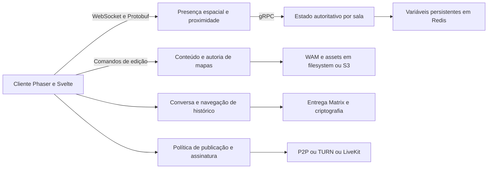

# Reduzir trabalho antes de trocar a linguagem

**Manter TypeScript, Svelte, Phaser e os contratos atuais na primeira rodada.** Há candidatos pequenos de atualização, alocação, retenção e renderização. Nenhum perfil coletado nesta auditoria justifica reescrever o backend.

## Go e Rust respondem a problemas diferentes

| Opção | Quando investigar | O que a troca não resolve sozinha |
|---|---|---|
| TypeScript atual | Menos filas, cópias, alocações, trabalho redundante e DOM | Precisa medir e limitar trabalho; linguagem familiar não elimina gargalos |
| Serviço isolado em Go | CPU/RSS de um serviço demonstradamente dominantes; fronteira estável de protocolo | Go tem GC. Não remove tráfego, replicação de eventos, mapas grandes ou decodificação no navegador |
| Kernel em Rust/WASM | Cálculo intensivo identificado, entradas compactas e processamento em lote | Cópias JS/WASM, inicialização, bundle e memória conjunta podem anular o benefício |
| Renderer substituto | Perfil prova limite estrutural do renderer após reduzir desenho e assets | Migração exige refazer tiles, câmera, animação, input, extensões e compatibilidade de GPU |
| Outra infraestrutura de mídia | Requisito ou custo medido que o LiveKit não atende | Novo provedor traz operação, contratos, reconexão e codecs; não economiza automaticamente banda |

Go inclui gerenciamento automático com coleta de lixo e tradeoff entre CPU e memória. Rust usa ownership para gerenciar a memória de seus valores sem depender de um coletor de rastreamento. Isso permite estratégias distintas, mas **não fornece uma proporção fixa de economia** para a aplicação. Fontes: [guia de GC do Go](https://go.dev/doc/gc-guide), [ownership Rust](https://doc.rust-lang.org/book/ch04-01-what-is-ownership.html), [conversões de strings JS/WASM](https://rustwasm.github.io/docs/wasm-bindgen/reference/types/string.html).

O [LiveKit já usa Go](https://github.com/livekit/livekit). O [uWebSockets.js é um módulo nativo V8/C++](https://github.com/uNetworking/uWebSockets.js/). O cliente Matrix auditado inicializa criptografia Rust. Reescrever sua orquestração em outra linguagem não substitui automaticamente os componentes que mais consomem recursos.

## Mapa de contextos proposto

O desenho identifica responsabilidades para discussão, não propõe criar seis novos serviços. Proximidade e colaboração espacial formam o núcleo mais evidente do produto. Conteúdo/autoria pode ser núcleo ou apoio conforme a estratégia dos mantenedores. Identidade, mídia e entrega de mensagens usam integrações especializadas.

O domínio deve nomear presença, sala, zona, sessão, movimento, comando de edição e confirmação durável com precisão. Confirmação de comando em memória não equivale a confirmação de gravação no armazenamento. O plano preserva essa semântica em vez de alterá-la silenciosamente.

## Aplicação das cinco skills

| Skill | Decisão concreta |
|---|---|
| Domain-driven design | Usar contextos e invariantes para limitar o escopo; sala e edição de mapa não ganham novos serviços só por aparecerem no diagrama |
| Contract-first | Reutilizar `messages/protos/messages.proto`, contratos JSON e `WAMFileFormat`; definir cap/replay/rejeição antes de mudar reconexão; gerar tipos dos contratos canônicos |
| Clean architecture | Isolar benchmark do código que exige `window`; testar autosave pelo `FileSystemInterface`; preservar cálculo de movimento independente de Phaser |
| Refactoring patterns | Remover trabalho temporário apenas quando medido; passos pequenos preservando saída, ordem e limpeza; atualização de pacote separada de extração estrutural |
| Clean code | Estados de salvamento e nomes explícitos; um motivo por alteração; não quebrar métodos apenas para satisfazer limite numérico de linhas |

`ChatConversation`, `ChatConnectionInterface` e `LiveKitRoomInterface` já existem. A última expõe `Room` do LiveKit; outras capacidades ainda são específicas do Matrix. Elas não representam independência completa de provedor. Uma nova abstração só vale quando existe outro consumidor/provedor ou problema demonstrado de teste. O [diagnóstico amostral](../evidence/skill-diagnostics.md) distingue evidência de itens ainda não inspecionados.

## Próximos três candidatos condicionais

### C1. Reduzir coleção intermediária na interpolação

`play/src/front/Phaser/Game/PlayersPositionInterpolator.ts` cria um `Map` a cada chamada. Seu consumidor de produção, `GameScene.ts`, itera imediatamente esse resultado. Comparar consumo síncrono direto com a implementação atual, sem biblioteca nova. Só executar se profiling indicar alocação/GC relevante nesse caminho.

Preservar ordem, interpolação, extrapolação, remoção e a última posição emitida uma vez quando um movimento expira. Preservar balões e atualização da viewport do jogador seguido. Os objetos de posição ainda podem ser alocados; não prometer zero alocação.

Verificar `play/tests/front/Phaser/Game/PlayerMovement.test.ts`, acrescentando somente casos observáveis ausentes do interpolador. Medir bytes alocados/segundo, GC e frame time em 20/100/500/1.000 avatares visíveis. Contrato interno TypeScript é suficiente; nenhum protocolo externo muda. Reversão restrita aos dois módulos. Descartar se a melhora estiver no ruído.

### C2. Limitar linhas montadas do histórico

`play/src/front/Chat/Components/Room/RoomTimeline.svelte` percorre todos os itens carregados e os monta com um `{#each}` comum. Paginar de 50 em 50 não limita o DOM acumulado. Se o perfil confirmar custo, experimentar janela de renderização com overscan e IDs estáveis, mantendo o histórico no provider.

Preservar âncora após inserir página antiga, resize de imagem/poll, salto para não lidas, foco em resposta/thread, intenção de seguir o final, agrupamento, edição, redaction, teclado e acessibilidade. Desmontagem não deve avançar recibos de leitura. Busca do navegador e seleção precisam de uma decisão de comportamento antes de publicar.

Reusar testes `RoomTimelineNewMessages.test.ts`, `RoomTimelineHeaderLayout.test.ts` e fluxos Playwright de read marker, sender, threads e message actions. Medir 100/1.000/10.000 eventos com alturas variadas. Janela pode reduzir DOM sem reduzir histórico em memória nem o custo de recomputar todos os itens. Exigir comparação visual e revisão de interação antes de merge; reverter o componente e helpers juntos. Dependência nova exige autorização.

### C3. Migrar Matrix com foco em ciclo de vida

Seguir o [plano de dependências](dependency-upgrades.md). Separar da virtualização para atribuir ganhos e regressões. Escopo inicial de manifests/lockfile e adaptação das APIs realmente utilizadas. Medir concorrência de buscas de threads, tempo até chat utilizável, reabertura do IndexedDB e atividade após logout. Reversão de pacote exige verificar previamente compatibilidade do armazenamento criptográfico local; não presumir downgrade seguro de banco.

## Decisões adiadas por falta de perfil

Não remover `structuredClone` do mapa diretamente. O código documenta proteção do cache contra mutações de scripting. Compartilhar referência mudaria visitas posteriores ao mapa. Inventariar mutações e medir pico de memória antes de explorar copy-on-write ou worker.

Dirty rendering, coalescência de movimentos, `adaptiveStream`, `dynacast` e `autoSubscribe:false` já existem. O caminho inicial é verificar se funcionam nas condições reais e quais custos permanecem.

Um eventual protótipo Go deverá comparar o mesmo serviço com o mesmo Protobuf, ordem, IDs, limpeza e roteamento. Um eventual protótipo Rust deverá incluir custos de fronteira, download e memória combinada. Só propor upstream se o ganho mensurado pagar implementação, operação e manutenção adicionais. A meta é experiência e capacidade, não uniformizar linguagem.
